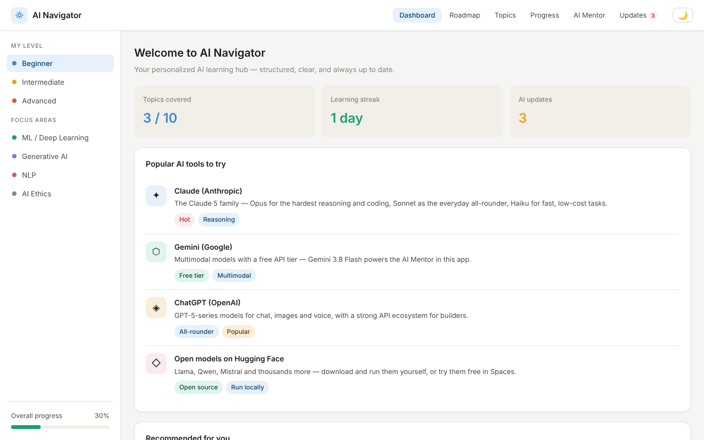
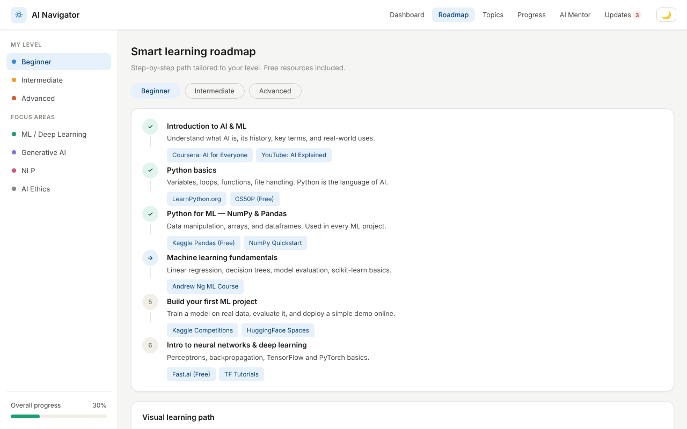
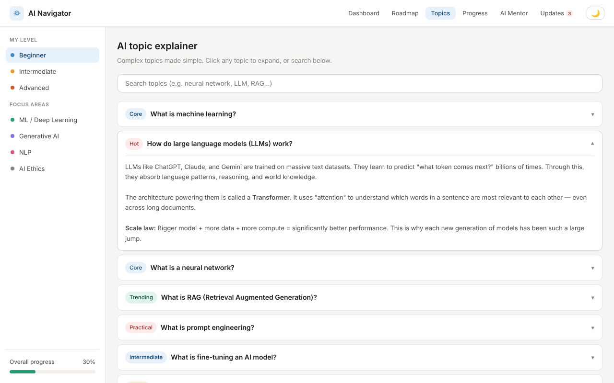
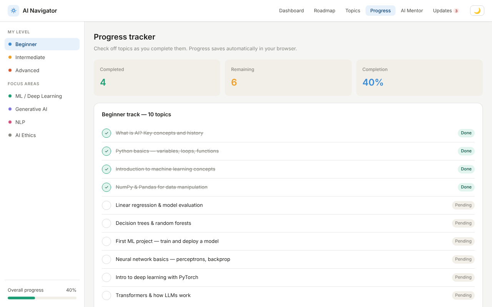
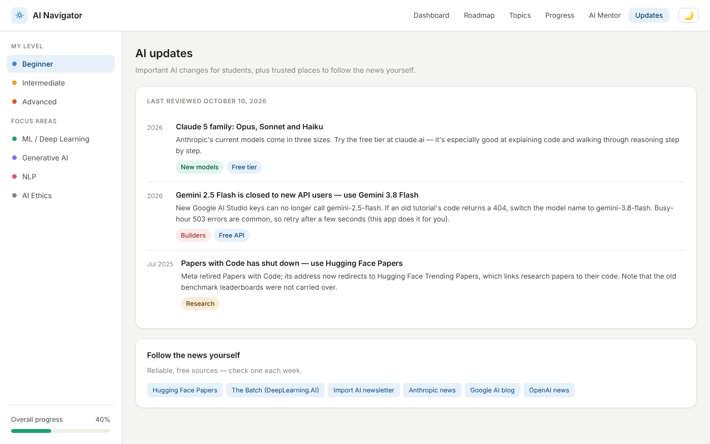
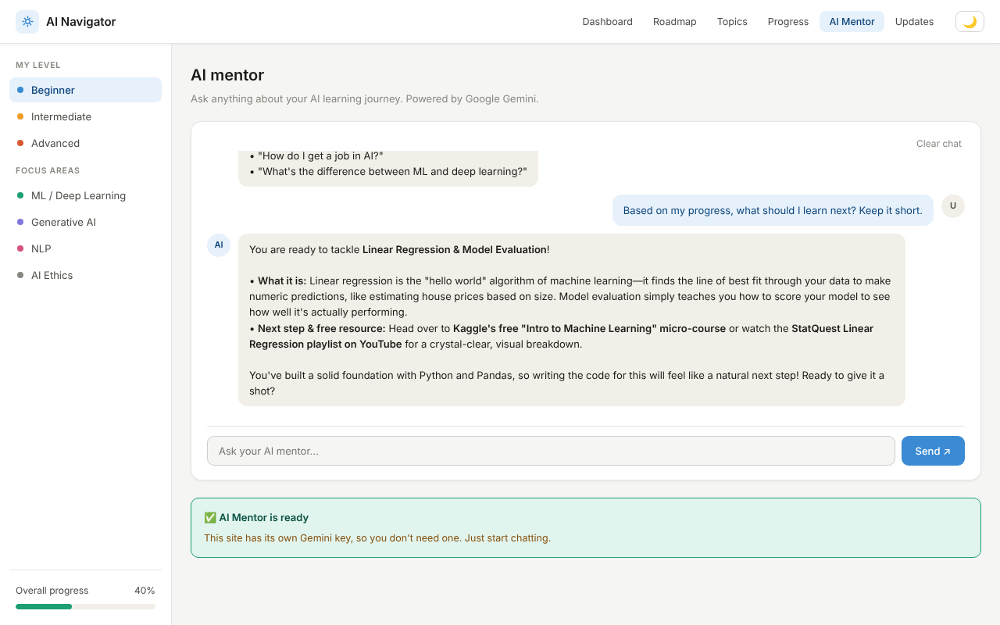
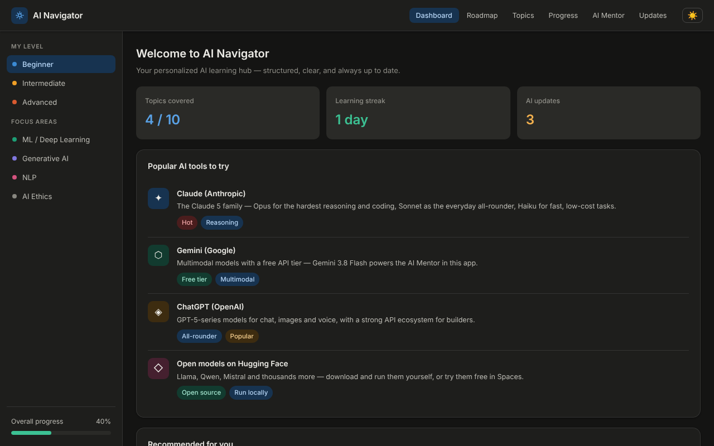
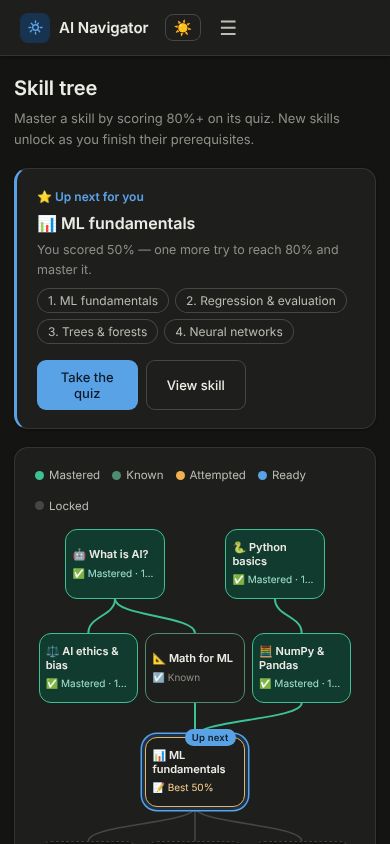

# AI Navigator


A free, structured AI learning hub for students, built with **Next.js**, **React** and **TypeScript**. It includes an AI Mentor powered by Google Gemini.



## Features

- **Dashboard:** your progress, learning streak, popular AI tools and suggested next steps.
- **Roadmap:** step-by-step learning paths for Beginner, Intermediate and Advanced levels, with free resources.
- **Topic explainer:** plain-language explanations of ML, LLMs, neural networks, RAG, prompt engineering, fine-tuning and AI bias. You can search them or filter by focus area.
- **Progress tracker:** a 10-topic checklist that saves in your browser.
- **AI Mentor:** a chat assistant powered by Google Gemini (`gemini-3.8-flash`). It knows your level and finished topics, remembers the conversation, formats its answers (lists, bold, links), retries automatically when Gemini is busy, and gives up after 60 seconds instead of hanging.
- **Server-side API key:** set `GEMINI_API_KEY` on the server and visitors can chat without a key of their own. The key never reaches the browser.
- **AI updates:** important changes for students, plus trusted news sources.
- **Dark mode**, a phone-friendly layout, and keyboard and screen-reader support.

## Screenshots

| Roadmap | Topic explainer |
|---|---|
|  |  |
| **Progress tracker** | **AI updates** |
|  |  |

### AI Mentor

The mentor knows your progress. After "NumPy & Pandas" was ticked off, it suggested the next unfinished topic:



| Dark mode | On a phone |
|---|---|
|  |  |

## Getting started

You need [Node.js](https://nodejs.org) **20.9 or newer**.

```bash
git clone https://github.com/Rishabh893-ux/AI-Navigator-.git
cd AI-Navigator-
npm install
npm run dev
```

Then open [http://localhost:3000](http://localhost:3000).

| Command | What it does |
|---|---|
| `npm run dev` | Starts the development server with live reload |
| `npm run build` | Builds the app for production |
| `npm start` | Runs the production build |
| `npm run lint` | Checks the code with ESLint |
| `npm run typecheck` | Checks the TypeScript types |

## Turning on the AI Mentor

Get a free key from [Google AI Studio](https://aistudio.google.com/app/apikey): sign in and click **Create API key**. Then choose one option.

**Option A: a server key (recommended).** Visitors don't need their own key.

1. Copy `.env.example` to `.env.local`.
2. Set `GEMINI_API_KEY=your-key` in `.env.local`.
3. Restart `npm run dev`.

The AI Mentor tab then shows **"AI Mentor is ready"**. `.env.local` is listed in `.gitignore`, so the key is never committed.

**Option B: each visitor uses their own key.** Leave `GEMINI_API_KEY` empty. Each visitor pastes their key into the yellow box in the AI Mentor tab. It's saved only in their browser and sent with their own messages.

> **Never commit an API key to this repository.** Keep it in `.env.local` or in your hosting provider's environment settings.

## Deploying (free on Vercel)

1. Push this repo to GitHub. It's already there.
2. Sign in at [vercel.com](https://vercel.com) with GitHub and click **Add New → Project**, then import `AI-Navigator-`.
3. Under **Environment Variables**, add `GEMINI_API_KEY` with your key.
4. Click **Deploy**. You get a public link like `ai-navigator.vercel.app`.

If you change the key later, redeploy so the new value is used.

## Project structure

```
AI-Navigator-/
├── app/
│   ├── layout.tsx           # Page shell: font, title, dark-mode script
│   ├── page.tsx             # Home page
│   ├── globals.css          # All styles (light and dark themes)
│   ├── icon.svg             # Browser tab icon
│   └── api/mentor/route.ts  # Server route that talks to Gemini
├── components/
│   ├── Navigator.tsx        # Main app: tabs, level, focus, progress, theme
│   ├── TopNav.tsx           # Top navigation bar
│   ├── Sidebar.tsx          # Level, focus areas, overall progress
│   ├── LearningPath.tsx     # "Visual learning path" diagram
│   ├── Tags.tsx             # Coloured tag pills
│   └── panels/              # One component per tab
├── lib/
│   ├── content.tsx          # All learning content: tools, roadmap, topics, updates
│   ├── mentor.ts            # Mentor prompt and shared types
│   ├── formatReply.ts       # Safe Markdown-to-HTML for mentor replies
│   └── storage.ts           # Safe localStorage helpers
├── docs/screenshots/        # Images used in this README
├── .env.example             # Template for your Gemini key
├── LICENSE                  # MIT License
└── package.json
```

## How the AI Mentor works

```
Browser  ──POST /api/mentor──▶  Next.js server  ──▶  Google Gemini
(chat + your level            (adds the system prompt,
 and finished topics)          the API key, limits and a timeout)
```

- The server checks and trims each request (at most 40 messages, 4,000 characters each).
- When the server key is used, each visitor can send 20 messages every 10 minutes, and requests from other websites are refused. This limit is stored in memory, so it's best-effort on serverless hosting.
- Busy (503) and rate-limit (429) errors from Gemini are retried up to 3 times, after 2s, 4s and 8s.

## Your data and privacy

Progress and settings stay in your browser's `localStorage`:

| Key | What it holds |
|---|---|
| `ain_progress` | Checklist progress |
| `ain_streak` | Learning streak |
| `ain_level` | Chosen level |
| `ain_theme` | Light or dark mode |
| `ain_chat` | AI Mentor conversation (last 40 messages) |
| `ain_gemini_key` | Your own Gemini key (Option B only) |
| `ain_updates_seen` | Whether you've read the latest updates |

These are the same keys the earlier single-file version used, so existing progress carries over on the same site. Mentor messages, your level and your finished topics are sent through this app's server to Google's Gemini API. Nothing else leaves your device.

## Updating content

- **Learning content:** edit `lib/content.tsx`. Tools, roadmap steps, topics, the checklist and updates all live there.
- **AI updates tab:** after editing `UPDATES`, bump `UPDATES_VERSION` so returning visitors see the "new" badge again.
- **Model:** set `GEMINI_MODEL` in `.env.local` (default `gemini-3.8-flash`).
- **Screenshots:** replace the images in `docs/screenshots/`, keeping the same file names.

## Troubleshooting

| Message in the chat | What to do |
|---|---|
| "API key not set" | Add `GEMINI_API_KEY` to `.env.local`, or paste your own key in the yellow box. |
| "API key not valid" | Create a new key in Google AI Studio and save it again. |
| "high demand" / "Gemini is busy" | Wait a minute and try again. The app already retries 3 times. |
| "Too many messages" | The per-visitor limit was reached. Wait 10 minutes. |
| "took too long to answer" | Gemini is slow right now. Send the message again. |

## Roadmap

Planned improvements:

- [x] Move to Next.js with a server-side API key
- [ ] Quizzes for each topic that tick off progress when passed
- [ ] Achievements and badges for streaks and finished tracks
- [ ] Export and import progress as a file
- [ ] Logins and cloud-saved progress
- [ ] Deploy to Vercel

## Tech

[Next.js 16](https://nextjs.org) (App Router), [React 19](https://react.dev), TypeScript and plain CSS. The Inter font is loaded with `next/font`.

## Contributing

Suggestions and fixes are welcome. Open an issue or a pull request. Run `npm run lint` and `npm run typecheck` before you push, and never commit API keys.

## License

Released under the [MIT License](LICENSE). You're free to use, copy, change and share this project, as long as you keep the copyright notice.
