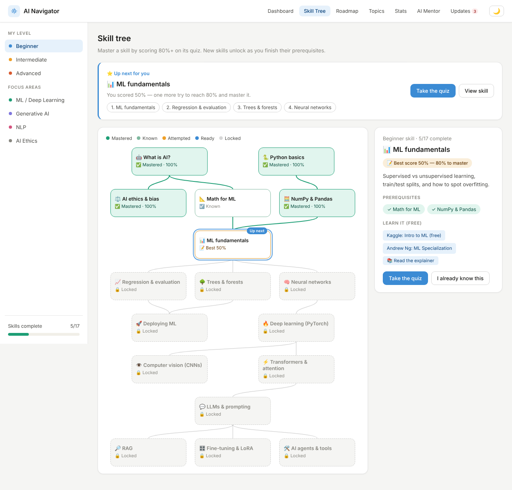
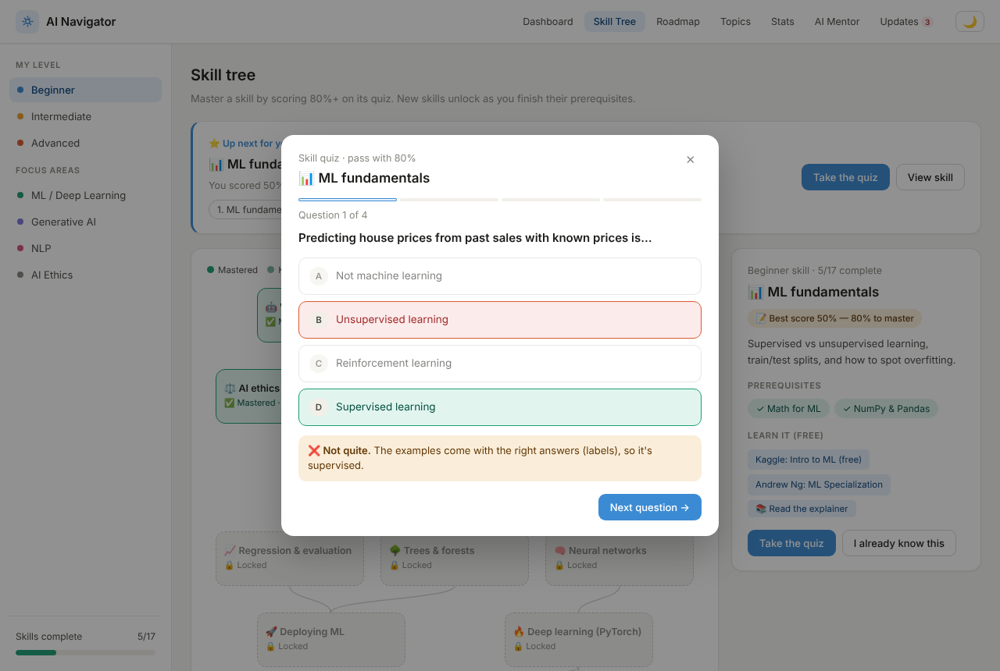
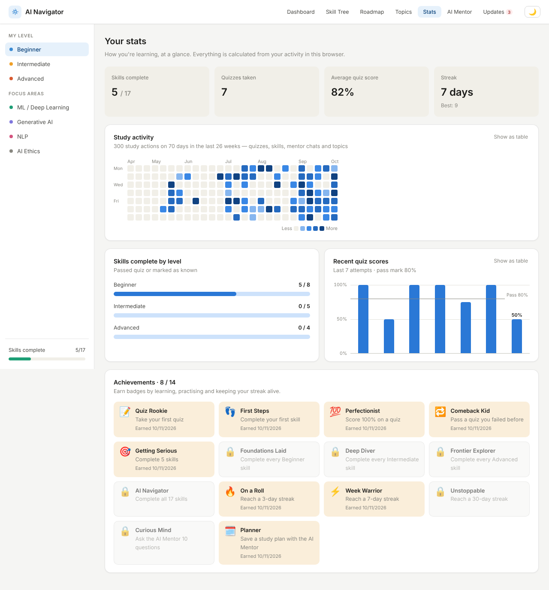
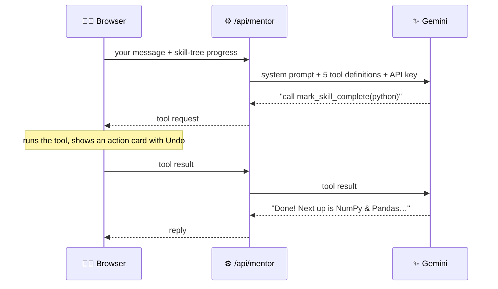

<div align="center">


# AI Navigator

**Your free, personal guide to learning AI: a game-style skill tree, quizzes, progress stats and an AI mentor agent that can act on your behalf.**

[](LICENSE)
[](https://nextjs.org)
[](https://react.dev)
[](https://www.typescriptlang.org)
[](https://ai.google.dev)
[](#-testing)

[**Features**](#-features) · [**Screenshots**](#-screenshots) · [**Quick start**](#-quick-start) · [**AI Mentor setup**](#-turn-on-the-ai-mentor) · [**Deploy**](#-deploy-for-free)


</div>

---

## 📖 Table of contents

- [About](#-about)
- [Features](#-features)
- [Screenshots](#-screenshots)
- [Quick start](#-quick-start)
- [Turn on the AI Mentor](#-turn-on-the-ai-mentor)
- [Deploy for free](#-deploy-for-free)
- [How the AI Mentor works](#-how-the-ai-mentor-works)
- [Project structure](#-project-structure)
- [Testing](#-testing)
- [Customise the content](#%EF%B8%8F-customise-the-content)
- [Privacy](#-privacy)
- [Troubleshooting](#-troubleshooting)
- [Roadmap](#%EF%B8%8F-roadmap)
- [Contributing](#-contributing)
- [License](#-license)

## 💡 About

Learning AI can feel overwhelming. There are too many courses, too much jargon, and it's hard to know what comes next. **AI Navigator** gives students one calm place to:

1. **follow a clear path**: a skill tree from Python basics to AI agents, where each skill unlocks the next,
2. **prove what you know** with a quiz for every skill,
3. **understand key ideas** in plain language,
4. **stay motivated** with streaks, badges and progress stats, and
5. **work with an AI mentor** that knows your progress and can quiz you, plan your weeks and update your skill tree for you.

It's free, open source, and your progress stays in your own browser.

## ✨ Features

| | Feature | What it does |
|---|---|---|
| 🌳 | **Skill tree** | 17 skills from *What is AI?* to *AI agents*. Each unlocks when its prerequisites are done, and the recommended next skill always glows |
| 📝 | **Skill quizzes** | 4 questions per skill with instant explanations. Score 80%+ to master it. Options are shuffled every attempt |
| 🧭 | **Adaptive path** | Always shows your best next step: retry a failed quiz first, then the unlocked skill closest to your chosen level |
| 🤖 | **Agent mentor** | A Gemini mentor that can **act**: mark skills done (with Undo), start quizzes, save study plans, change your level and open pages |
| 🗓️ | **Study plans** | The mentor builds a week-by-week plan around your progress and saves it to your dashboard, where weeks tick off as you go |
| 🏆 | **Achievements** | 14 badges for quizzes, skills, streaks and more, with a pop-up when you unlock one |
| 📊 | **Stats** | Activity heatmap, skills complete by level, quiz score history and a trophy shelf, each with a table view |
| 🗺️ | **Roadmap** | Curated free resources per level. Ticks follow your real skill progress |
| 📚 | **Topic explainer** | ML, LLMs, neural networks, RAG, prompt engineering, fine-tuning and AI bias, explained simply |
| 🔐 | **Secure API key** | Keep your Gemini key on the server, so visitors chat without needing their own |
| 📰 | **AI updates** | Important changes for students, plus trusted news sources |
| 🌙 | **Dark mode & mobile** | Follows your system theme, works on phones, and supports keyboard and screen readers |

## 📸 Screenshots

### 🌳 Skill tree

Skills unlock as you finish their prerequisites. Your recommended next skill and learning path are always at the top:



### 🤖 The agent mentor takes action

Asked for a study plan, the mentor built one around this learner's progress and **saved it to the dashboard** itself:


<table>
  <tr>
    <td width="50%"><b>📝 Skill quiz</b><br/></td>
    <td width="50%"><b>📊 Stats</b><br/></td>
  </tr>
  <tr>
    <td><b>🗺️ Roadmap</b><br/></td>
    <td><b>📚 Topic explainer</b><br/></td>
  </tr>
  <tr>
    <td><b>🌙 Dark mode</b><br/></td>
    <td align="center"><b>📱 On a phone</b><br/></td>
  </tr>
</table>

## 🚀 Quick start

> **You need:** [Node.js](https://nodejs.org) **20.9 or newer**.

```bash
git clone https://github.com/Rishabh893-ux/AI-Navigator-.git
cd AI-Navigator-
npm install
npm run dev
```

Open **[http://localhost:3000](http://localhost:3000)**. 🎉

| Command | What it does |
|---|---|
| `npm run dev` | Start the development server, with live reload |
| `npm run build` | Build for production |
| `npm start` | Run the production build |
| `npm run lint` | Check the code with ESLint |
| `npm run typecheck` | Check the TypeScript types |
| `npm test` | Run the unit tests |

## 🔑 Turn on the AI Mentor

First, get a **free** key from [Google AI Studio](https://aistudio.google.com/app/apikey): sign in and click **Create API key**. Then pick one option.

### Option A: server key (recommended)

Visitors don't need a key of their own.

```bash
cp .env.example .env.local
# then open .env.local and set:
# GEMINI_API_KEY=your-key-here
```

Restart `npm run dev`. The AI Mentor tab then shows **✅ AI Mentor is ready**.

### Option B: each visitor brings their own key

Leave `GEMINI_API_KEY` empty. Each visitor pastes their key into the yellow box in the AI Mentor tab. It's saved only in their browser.

> [!WARNING]
> **Never commit an API key.** Keep it in `.env.local`, which is already in `.gitignore`, or in your hosting provider's settings.

## 🌍 Deploy for free

Put AI Navigator online with [Vercel](https://vercel.com), the company behind Next.js:

1. Sign in at **[vercel.com](https://vercel.com)** with your GitHub account.
2. Click **Add New → Project** and import **`AI-Navigator-`**.
3. Under **Environment Variables**, add `GEMINI_API_KEY` with your key.
4. Click **Deploy**. You'll get a public link to share. 🚀

> [!TIP]
> If you change the key later, click **Redeploy** in Vercel so the new value is used.

## 🧠 How the AI Mentor works

The mentor is an **AI agent**: Gemini can ask the app to run tools, and the browser runs them, because your progress lives there.



| Tool | What it does |
|---|---|
| `mark_skill_complete` | Marks a skill you already know as complete (with **Undo**) |
| `start_quiz` | Opens the quiz for a skill, if it's unlocked |
| `open_page` | Opens a tab, a skill in the tree, or a topic explainer |
| `save_study_plan` | Saves a week-by-week plan to your dashboard |
| `set_level` | Changes your level (Beginner, Intermediate or Advanced) |

- **It knows you:** every request includes your skill statuses, quiz scores, weak spots, streak and recommended next skill.
- **Safe by design:** the browser checks every tool request before running it (unknown skills, locked quizzes and empty plans are refused). The server checks every message, the key never reaches the browser, and replies are cleaned before they're shown.
- **Fair use:** with the server key, each visitor can make 40 requests every 10 minutes (each tool step counts), and other websites are blocked.
- **Reliable:** when Gemini is busy (503 or 429), the app retries after 2s, 4s and 8s. It doesn't retry a used-up quota, gives up cleanly after 60 seconds, and stops after 4 tool steps.

## 📁 Project structure

```
AI-Navigator-/
├── app/
│   ├── layout.tsx            # Page shell: font, title, dark-mode script
│   ├── page.tsx              # Home page
│   ├── globals.css           # All styles (light and dark themes)
│   ├── icon.svg              # Browser tab icon
│   └── api/mentor/route.ts   # Server route: Gemini + tool calling
├── components/
│   ├── Navigator.tsx         # Main app: tabs, quiz window, mentor tools
│   ├── useLearner.ts         # Progress, quizzes, streak, badges (saved in the browser)
│   ├── SkillTree.tsx         # The skill tree diagram
│   ├── QuizDialog.tsx        # Quiz window
│   ├── Toasts.tsx            # "Achievement unlocked" pop-ups
│   ├── TopNav.tsx · Sidebar.tsx · LearningPath.tsx · Tags.tsx
│   └── panels/               # One component per tab
├── lib/
│   ├── skills.ts             # ✏️ Skills, quizzes, unlocking and recommendations
│   ├── content.tsx           # ✏️ Tools, roadmap, topics and updates
│   ├── achievements.ts       # Badges and their rules
│   ├── activity.ts           # Streaks and the activity heatmap data
│   ├── mentor.ts             # Mentor prompt and shared types
│   ├── mentorTools.ts        # The 5 tools the mentor can call
│   ├── plan.ts               # Study plan validation
│   ├── formatReply.ts        # Safe Markdown-to-HTML for replies
│   └── storage.ts            # Safe localStorage helpers
├── tests/                    # Unit tests (Vitest)
├── docs/                     # Logo and README screenshots
├── .env.example              # Template for your Gemini key
└── package.json
```

## 🧪 Testing

```bash
npm test
```

31 unit tests check the core logic:
- the skill tree (no loops, valid quizzes, unlocking, mastery, the recommended path);
- badges, streaks across month boundaries, and migration of old saved data;
- the mentor prompt, history trimming and study-plan validation;
- that replies can't inject HTML.

## ✏️ Customise the content

Learning content lives in two files:

| To change… | Edit |
|---|---|
| Skills, prerequisites, resources and quiz questions | `SKILLS` in [`lib/skills.ts`](lib/skills.ts). `row` places a skill in the tree (max 3 per row) |
| The pass mark | `PASS_MARK` in `lib/skills.ts` (default 80%) |
| Badges | `ACHIEVEMENTS` in [`lib/achievements.ts`](lib/achievements.ts) |
| Popular AI tools | `TOOLS` in [`lib/content.tsx`](lib/content.tsx) |
| Roadmap steps and links | `ROADMAP` in `lib/content.tsx`. Each step links to a `skill` |
| Topic explanations | `TOPICS` in `lib/content.tsx` |
| AI updates and news sources | `UPDATES` and `NEWS_SOURCES`, then bump `UPDATES_VERSION` so returning visitors see the "new" badge |

When you add a quiz question, put the correct answer anywhere in `options` and set `answer` to its index. The app shuffles the options for every attempt.

To use a different Gemini model, set `GEMINI_MODEL` in `.env.local`. The default is `gemini-3.8-flash`.

## 🔒 Privacy

Your progress and settings stay **in your own browser**. Mentor messages, your level and your skill progress are sent through this app's server to Google Gemini. Nothing else leaves your device. Progress from the earlier checklist version is carried over automatically.

<details>
<summary><b>What's stored in your browser</b></summary>

| Key | What it holds |
|---|---|
| `ain_skills` | Skill progress: completed, best quiz score, attempts |
| `ain_quiz_log` | Quiz history (last 200 attempts) |
| `ain_activity` | Study actions per day (for the heatmap) |
| `ain_achievements` | Badges earned, and when |
| `ain_plan` | The study plan saved by the mentor |
| `ain_counters` | Number of mentor messages (for a badge) |
| `ain_streak` | Learning streak and best streak |
| `ain_level` | Chosen level |
| `ain_theme` | Light or dark mode |
| `ain_chat` | AI Mentor conversation |
| `ain_gemini_key` | Your own Gemini key (Option B only) |
| `ain_updates_seen` | Whether you've read the latest updates |
| `ain_progress` | The old checklist (read once, to carry progress over) |

To reset everything, clear this site's data in your browser settings.

</details>

## 🛠 Troubleshooting

<details>
<summary><b>The mentor shows an error message</b></summary>

| Message | What to do |
|---|---|
| "API key not set" | Add `GEMINI_API_KEY` to `.env.local`, or paste your own key in the yellow box |
| "API key not valid" | Create a new key in Google AI Studio and save it again |
| "Gemini is busy" / "high demand" | Wait a minute. The app already retries 3 times |
| "Too many messages" | The per-visitor limit was reached. Wait 10 minutes |
| "quota … used up" | The key's free Gemini quota ran out. Try later, or use another key |
| "I stopped after several steps" | The mentor hit its 4-step limit. Ask it to continue |
| "took too long to answer" | Gemini is slow right now. Send the message again |

</details>

<details>
<summary><b><code>npm install</code> or <code>npm run dev</code> fails</b></summary>

- Check your Node.js version with `node -v`. It must be **20.9 or newer**.
- Delete `node_modules` and `package-lock.json`, then run `npm install` again.
- If port 3000 is busy, run `npm run dev -- -p 3001`.

</details>

## 🗺️ Roadmap

- [x] Move to Next.js with a server-side API key
- [x] Skill tree with quizzes and an adaptive learning path
- [x] Agent mentor with tool calling
- [x] Achievements, badges and a stats dashboard
- [ ] Export and import progress as a file
- [ ] Streaming (word-by-word) mentor replies
- [ ] Logins and cloud-saved progress
- [ ] Live demo on Vercel

## 🤝 Contributing

Contributions are welcome! 💙

1. Fork the repo and create a branch: `git checkout -b my-feature`
2. Make your changes, then run `npm run lint`, `npm run typecheck` and `npm test`
3. Open a pull request describing what you changed

Please **never commit API keys** or other secrets.

## 📄 License

Released under the [MIT License](LICENSE). You're free to use, copy, change and share this project, as long as you keep the copyright notice.

<div align="center">

---

Made by - [Rishabh](https://github.com/Rishabh893-ux)

⭐ **If AI Navigator helps you, please give it a star!** ⭐

</div>
