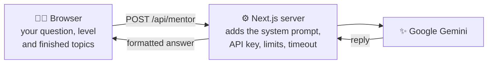

<div align="center">


# AI Navigator

**Your free, personal guide to learning AI: clear roadmaps, simple explanations and an AI mentor that knows your progress.**

[](LICENSE)
[](https://nextjs.org)
[](https://react.dev)
[](https://www.typescriptlang.org)
[](https://ai.google.dev)

[**Features**](#-features) · [**Screenshots**](#-screenshots) · [**Quick start**](#-quick-start) · [**AI Mentor setup**](#-turn-on-the-ai-mentor) · [**Deploy**](#-deploy-for-free)


</div>

---

## 📖 Table of contents

- [About](#-about)
- [Features](#-features)
- [Screenshots](#-screenshots)
- [Quick start](#-quick-start)
- [Turn on the AI Mentor](#-turn-on-the-ai-mentor)
- [Deploy for free](#-deploy-for-free)
- [How the AI Mentor works](#-how-the-ai-mentor-works)
- [Project structure](#-project-structure)
- [Customise the content](#%EF%B8%8F-customise-the-content)
- [Privacy](#-privacy)
- [Troubleshooting](#-troubleshooting)
- [Roadmap](#%EF%B8%8F-roadmap)
- [Contributing](#-contributing)
- [License](#-license)

## 💡 About

Learning AI can feel overwhelming. There are too many courses, too much jargon, and it's hard to know what comes next. **AI Navigator** gives students one calm place to:

1. **follow a clear path** from Python basics to advanced AI,
2. **understand key ideas** in plain language,
3. **track progress** and build a daily learning habit, and
4. **ask an AI mentor** that gives advice based on what you've already finished.

It's free, open source, and your progress stays in your own browser.

## ✨ Features

| | Feature | What it does |
|---|---|---|
| 🏠 | **Dashboard** | Your progress, learning streak, popular AI tools and suggested next steps |
| 🗺️ | **Roadmap** | Step-by-step paths for Beginner, Intermediate and Advanced, with free resources |
| 📚 | **Topic explainer** | ML, LLMs, neural networks, RAG, prompt engineering, fine-tuning and AI bias, explained simply. Search them or filter by focus area |
| ✅ | **Progress tracker** | A 10-topic checklist that saves automatically |
| 🤖 | **AI Mentor** | Gemini-powered chat that knows your level and finished topics, and remembers the conversation |
| 🔐 | **Secure API key** | Keep your Gemini key on the server, so visitors chat without needing their own |
| 📰 | **AI updates** | Important changes for students, plus trusted news sources |
| 🌙 | **Dark mode** | Follows your system setting and remembers your choice |
| 📱 | **Works everywhere** | Phone-friendly layout, with keyboard and screen-reader support |

## 📸 Screenshots

<table>
  <tr>
    <td width="50%"><b>🗺️ Roadmap</b><br/></td>
    <td width="50%"><b>📚 Topic explainer</b><br/></td>
  </tr>
  <tr>
    <td><b>✅ Progress tracker</b><br/></td>
    <td><b>📰 AI updates</b><br/></td>
  </tr>
</table>

### 🤖 The AI Mentor knows your progress

After *"NumPy & Pandas"* was ticked off, the mentor suggested the next unfinished topic:


<table>
  <tr>
    <td width="68%"><b>🌙 Dark mode</b><br/></td>
    <td width="32%" align="center"><b>📱 On a phone</b><br/></td>
  </tr>
</table>

## 🚀 Quick start

> **You need:** [Node.js](https://nodejs.org) **20.9 or newer**.

```bash
git clone https://github.com/Rishabh893-ux/AI-Navigator-.git
cd AI-Navigator-
npm install
npm run dev
```

Open **[http://localhost:3000](http://localhost:3000)**. 🎉

| Command | What it does |
|---|---|
| `npm run dev` | Start the development server, with live reload |
| `npm run build` | Build for production |
| `npm start` | Run the production build |
| `npm run lint` | Check the code with ESLint |
| `npm run typecheck` | Check the TypeScript types |

## 🔑 Turn on the AI Mentor

First, get a **free** key from [Google AI Studio](https://aistudio.google.com/app/apikey): sign in and click **Create API key**. Then pick one option.

### Option A: server key (recommended)

Visitors don't need a key of their own.

```bash
cp .env.example .env.local
# then open .env.local and set:
# GEMINI_API_KEY=your-key-here
```

Restart `npm run dev`. The AI Mentor tab then shows **✅ AI Mentor is ready**.

### Option B: each visitor brings their own key

Leave `GEMINI_API_KEY` empty. Each visitor pastes their key into the yellow box in the AI Mentor tab. It's saved only in their browser.

> [!WARNING]
> **Never commit an API key.** Keep it in `.env.local`, which is already in `.gitignore`, or in your hosting provider's settings.

## 🌍 Deploy for free

Put AI Navigator online with [Vercel](https://vercel.com), the company behind Next.js:

1. Sign in at **[vercel.com](https://vercel.com)** with your GitHub account.
2. Click **Add New → Project** and import **`AI-Navigator-`**.
3. Under **Environment Variables**, add `GEMINI_API_KEY` with your key.
4. Click **Deploy**. You'll get a public link to share. 🚀

> [!TIP]
> If you change the key later, click **Redeploy** in Vercel so the new value is used.

## 🧠 How the AI Mentor works



- **Personal advice:** your level and finished topics are sent along, so the mentor suggests your real next step.
- **Safe by design:** the server key never reaches the browser. Replies are cleaned before they're shown.
- **Fair use:** with the server key, each visitor can send 20 messages every 10 minutes, and other websites are blocked.
- **Reliable:** when Gemini is busy (503 or 429), the app retries after 2s, 4s and 8s, and gives up cleanly after 60 seconds.

## 📁 Project structure

```
AI-Navigator-/
├── app/
│   ├── layout.tsx            # Page shell: font, title, dark-mode script
│   ├── page.tsx              # Home page
│   ├── globals.css           # All styles (light and dark themes)
│   ├── icon.svg              # Browser tab icon
│   └── api/mentor/route.ts   # Server route that talks to Gemini
├── components/
│   ├── Navigator.tsx         # Main app: tabs, level, focus, progress, theme
│   ├── TopNav.tsx            # Top navigation bar
│   ├── Sidebar.tsx           # Level, focus areas, overall progress
│   ├── LearningPath.tsx      # "Visual learning path" diagram
│   ├── Tags.tsx              # Coloured tag pills
│   └── panels/               # One component per tab
├── lib/
│   ├── content.tsx           # ✏️ All learning content lives here
│   ├── mentor.ts             # Mentor prompt and shared types
│   ├── formatReply.ts        # Safe Markdown-to-HTML for replies
│   └── storage.ts            # Safe localStorage helpers
├── docs/                     # Logo and README screenshots
├── .env.example              # Template for your Gemini key
└── package.json
```

## ✏️ Customise the content

Everything you see in the app comes from **one file**, [`lib/content.tsx`](lib/content.tsx):

| To change… | Edit |
|---|---|
| Popular AI tools | `TOOLS` |
| Roadmap steps and links | `ROADMAP` |
| Topic explanations | `TOPICS` |
| Progress checklist | `COURSES` |
| AI updates and news sources | `UPDATES` and `NEWS_SOURCES`, then bump `UPDATES_VERSION` so returning visitors see the "new" badge |

To use a different Gemini model, set `GEMINI_MODEL` in `.env.local`. The default is `gemini-3.8-flash`.

## 🔒 Privacy

Your progress and settings stay **in your own browser**. Mentor messages, your level and your finished topics are sent through this app's server to Google Gemini. Nothing else leaves your device.

<details>
<summary><b>What's stored in your browser</b></summary>

| Key | What it holds |
|---|---|
| `ain_progress` | Checklist progress |
| `ain_streak` | Learning streak |
| `ain_level` | Chosen level |
| `ain_theme` | Light or dark mode |
| `ain_chat` | AI Mentor conversation (last 40 messages) |
| `ain_gemini_key` | Your own Gemini key (Option B only) |
| `ain_updates_seen` | Whether you've read the latest updates |

To reset everything, clear this site's data in your browser settings.

</details>

## 🛠 Troubleshooting

<details>
<summary><b>The mentor shows an error message</b></summary>

| Message | What to do |
|---|---|
| "API key not set" | Add `GEMINI_API_KEY` to `.env.local`, or paste your own key in the yellow box |
| "API key not valid" | Create a new key in Google AI Studio and save it again |
| "Gemini is busy" / "high demand" | Wait a minute. The app already retries 3 times |
| "Too many messages" | The per-visitor limit was reached. Wait 10 minutes |
| "took too long to answer" | Gemini is slow right now. Send the message again |

</details>

<details>
<summary><b><code>npm install</code> or <code>npm run dev</code> fails</b></summary>

- Check your Node.js version with `node -v`. It must be **20.9 or newer**.
- Delete `node_modules` and `package-lock.json`, then run `npm install` again.
- If port 3000 is busy, run `npm run dev -- -p 3001`.

</details>

## 🗺️ Roadmap

- [x] Move to Next.js with a server-side API key
- [ ] Quizzes for each topic that tick off progress when passed
- [ ] Achievements and badges for streaks and finished tracks
- [ ] Export and import progress as a file
- [ ] Logins and cloud-saved progress
- [ ] Live demo on Vercel

## 🤝 Contributing

Contributions are welcome! 💙

1. Fork the repo and create a branch: `git checkout -b my-feature`
2. Make your changes, then run `npm run lint` and `npm run typecheck`
3. Open a pull request describing what you changed

Please **never commit API keys** or other secrets.

## 📄 License

Released under the [MIT License](LICENSE). You're free to use, copy, change and share this project, as long as you keep the copyright notice.

<div align="center">

---

Made with 💙 by [Rishabh](https://github.com/Rishabh893-ux)

⭐ **If AI Navigator helps you, please give it a star!** ⭐

</div>
